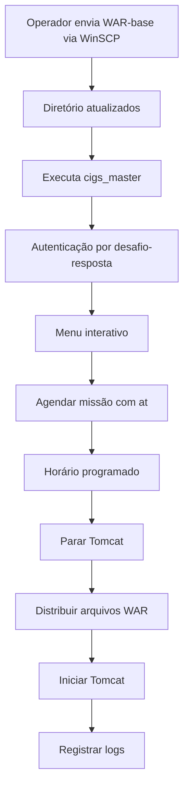
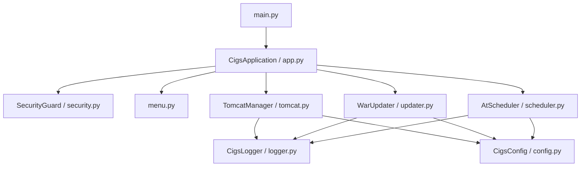

# 🖥️ C.I.G.S — Central de Operações Linux

> Ferramenta de linha de comando para automatizar a distribuição de arquivos WAR, controlar o Apache Tomcat e agendar operações em servidores Linux, com autenticação por sessão e registros de auditoria.

[](https://www.python.org/)

[](https://pyinstaller.org/)


> [!IMPORTANT]
> Projeto destinado a operações autorizadas. Antes de utilizá-lo em produção, valide os caminhos, permissões, backups, estratégia de recuperação e compatibilidade com seu ambiente. Os comandos e estruturas abaixo são exemplos baseados na documentação do projeto.

## 📑 Sumário

- [Visão geral](#-visão-geral)
- [Funcionalidades](#-funcionalidades)
- [Fluxo operacional](#-fluxo-operacional)
- [Arquitetura](#-arquitetura)
- [Pré-requisitos](#-pré-requisitos)
- [Instalação no servidor](#-instalação-no-servidor)
- [Operação diária](#-operação-diária)
- [Compilação](#-compilação)
- [Segurança](#-segurança)
- [Estrutura do projeto](#-estrutura-do-projeto)
- [Configuração](#-configuração)
- [Logs e auditoria](#-logs-e-auditoria)
- [Solução de problemas](#-solução-de-problemas)
- [Roadmap](#-roadmap)
- [Contribuição](#-contribuição)
- [Licença e autoria](#-licença-e-autoria)

## 🎯 Visão geral

O **C.I.G.S (Central de Operações Linux)** evoluiu de um script Bash monolítico (`operacao_tatica.sh`) para uma aplicação **Python 3**, estruturada em módulos com responsabilidades específicas.

O sistema centraliza operações de manutenção em instalações do **Apache Tomcat** que hospedam múltiplos clientes, permitindo distribuir um WAR-base, executar comandos de inicialização e parada, agendar tarefas com `at` e consultar logs.

**Objetivos do projeto:**

- **Robustez:** tratamento explícito de erros.
- **Auditabilidade:** logs por execução, com horários e níveis.
- **Usabilidade:** menu interativo contínuo.
- **Manutenibilidade:** separação de responsabilidades e configuração centralizada.
- **Distribuição:** empacotamento de executável Linux com PyInstaller.

## ✨ Funcionalidades

| Opção | Recurso | Descrição |
|:---:|---|---|
| `1` | Parar Tomcat | Executa `shutdown.sh` e aguarda 10 segundos. |
| `2` | Atualizar WARs | Distribui o WAR-base para os arquivos `fortesrh*.war` dos clientes. |
| `3` | Iniciar Tomcat | Executa `startup.sh`. |
| `4` | Agendar missão | Agenda uma operação automatizada utilizando `at`. |
| `5` | Listar agendamentos | Consulta a fila de tarefas com `atq`. |
| `6` | Sair | Encerra a sessão e exige nova autenticação no próximo acesso. |

**Recursos adicionais descritos no projeto:** autenticação por desafio-resposta, logs por execução e tentativa de recuperação do Tomcat em caso de falha na atualização.

> [!WARNING]
> A recuperação descrita não substitui uma política de backup e rollback de arquivos WAR. Valide a implementação e teste falhas antes de operar em produção.

## 🔄 Fluxo operacional



O fluxo padrão de produção utiliza a **opção 4**, que agenda a sequência de parada, atualização e inicialização do Tomcat.

## 🏗️ Arquitetura

A organização proposta utiliza orientação a objetos, **Single Responsibility Principle (SRP)**, injeção explícita de dependências e configurações centralizadas em uma `dataclass` imutável (`CigsConfig`).



| Módulo | Responsabilidade |
|---|---|
| `main.py` | Ponto de entrada da aplicação. |
| `app.py` | Orquestração dos componentes. |
| `config.py` | Caminhos, constantes e variáveis de ambiente. |
| `logger.py` | Registro em console e arquivo. |
| `security.py` | Validação de acesso por desafio-resposta. |
| `tomcat.py` | Controle de inicialização e parada do Tomcat. |
| `updater.py` | Distribuição dos WARs. |
| `scheduler.py` | Integração com `at` e `atq`. |
| `menu.py` | Interface de linha de comando. |

## 📦 Pré-requisitos

### Servidor

- Distribuição Linux compatível com o executável gerado (ambientes citados no projeto: Ubuntu Server 20.04+, Debian 11+, CentOS 7+ e Oracle Linux 8+).
- Apache Tomcat 9.x instalado e configurado.
- Acesso administrativo autorizado (`root` ou `sudo`).
- Utilitário `at` e serviço `atd`.
- Diretórios de trabalho com permissões apropriadas.

> [!NOTE]
> A compatibilidade efetiva do binário depende da distribuição, arquitetura e bibliotecas do sistema de build. A lista acima não representa uma matriz de testes certificada.

### Desenvolvimento e build

- Python 3.10 ou superior.
- Linux nativo, WSL2 com Ubuntu ou contêiner Linux compatível.
- PyInstaller.

O PyInstaller deve gerar o executável no sistema operacional de destino: **um build Linux precisa ser feito em ambiente Linux**.

## 🚀 Instalação no servidor

### 1. Preparar os diretórios

Exemplo de diretório de instalação (ajuste para sua infraestrutura):

```bash
sudo mkdir -p /opt/cigs/{atualizados,logs}
```

### 2. Instalar o agendador

**Ubuntu / Debian:**

```bash
sudo apt update
sudo apt install -y at
sudo systemctl enable --now atd
```

**Distribuições baseadas em RPM:**

```bash
sudo dnf install -y at
sudo systemctl enable --now atd
```

Em distribuições antigas, o gerenciador de pacotes pode ser `yum`.

### 3. Copiar e preparar o executável

Transfira `dist/cigs_master` para o diretório escolhido (por exemplo, via WinSCP) e conceda permissão de execução:

```bash
sudo chmod +x /opt/cigs/cigs_master
```

Configure as variáveis de ambiente de acordo com os caminhos reais do Tomcat e do C.I.G.S antes de executar.

### 4. Testar a inicialização

```bash
sudo /opt/cigs/cigs_master
```

A interface de autenticação deve ser exibida. Verifique as permissões de leitura, escrita e execução necessárias.

## 🎮 Operação diária

1. Envie o WAR-base para `atualizados/fortesrh.war`.
2. Acesse o servidor por SSH (por exemplo, PuTTY).
3. Inicie o `cigs_master` com as permissões necessárias.
4. Realize a autenticação da sessão.
5. Selecione a operação desejada no menu.
6. Para uma missão programada, escolha **4** e informe o horário (por exemplo, `19:30`).
7. Confira a fila com a opção **5** e encerre o programa com **6**.
8. Após o horário previsto, consulte os logs para verificar o resultado.

> [!CAUTION]
> A opção **2** deve ser utilizada somente com o Tomcat parado, conforme a documentação original. Planeje uma janela de manutenção e confirme que os clientes podem ser afetados pela indisponibilidade.

## 🔨 Compilação

### WSL2 no Windows

No PowerShell com privilégios administrativos:

```powershell
wsl --install -d Ubuntu
```

No terminal Ubuntu:

```bash
sudo apt update
sudo apt install -y python3 python3-pip python3-venv
cd /mnt/c/Users/SEU_USUARIO/Documents/Project_Python
chmod +x build.sh
./build.sh
```

O executável esperado estará em `dist/cigs_master`.

### Build manual

```bash
python3 -m venv .venv
source .venv/bin/activate
python -m pip install --upgrade pip pyinstaller

pyinstaller \
  --onefile \
  --name cigs_master \
  --strip \
  --console \
  --paths . \
  main.py
```

Para testar no ambiente Linux de desenvolvimento:

```bash
./dist/cigs_master
```

> [!NOTE]
> O teste local pode exigir configurações e diretórios simulados. Evite apontar testes para instalações de produção.

## 🔐 Segurança

O mecanismo documentado utiliza **desafio-resposta numérico**, com um desafio gerado a cada autenticação. Após o acesso autorizado, a sessão permanece ativa até a saída do programa.

**Limitações conhecidas:**

- Desafio-resposta com constantes embutidas ou ofuscadas **não é autenticação criptograficamente forte**.
- PyInstaller empacota bytecode Python e **não impede engenharia reversa**.
- Executar como administrador amplia o impacto de falhas ou uso indevido.
- A validação de uma sessão interativa não equivale à autorização de cada tarefa agendada.

**Recomendações:** restringir acesso por SSH e permissões de sistema, proteger credenciais e configurações, registrar operações, usar gerenciamento de segredos e considerar autenticação robusta antes de ampliar o uso.

O código da fórmula de desafio-resposta e as constantes originais foram omitidos deste README público. **Essa omissão não protege o mecanismo se os mesmos valores estiverem no código-fonte publicado.**

## 📂 Estrutura do projeto

### Repositório

```text
Project_Python/
├── main.py
├── requirements.txt
├── build.sh
├── README.md
└── CIGS_linux/
    ├── __init__.py
    ├── app.py
    ├── config.py
    ├── logger.py
    ├── menu.py
    ├── scheduler.py
    ├── security.py
    ├── tomcat.py
    └── updater.py
```

### Servidor (exemplo genérico)

```text
/opt/cigs/
├── cigs_master
├── atualizados/
│   └── fortesrh.war
└── logs/
    ├── operacao_DD-MM-AAAA_HH-MM-SS.log
    └── ...

/opt/tomcat/
├── bin/
│   ├── startup.sh
│   └── shutdown.sh
└── webapps/
    ├── fortesrh_clienteA.war
    ├── fortesrh_clienteB.war
    └── fortesrh_clienteC.war
```

## ⚙️ Configuração

O projeto documenta estas variáveis de ambiente:

| Variável | Finalidade | Exemplo |
|---|---|---|
| `CIGS_BASE` | Diretório de trabalho | `/opt/cigs` |
| `CIGS_TOMCAT_HOME` | Diretório raiz do Tomcat | `/opt/tomcat` |
| `CIGS_EXECUTAVEL` | Caminho do executável | `/opt/cigs/cigs_master` |

Exemplo de configuração de uma sessão Linux:

```bash
export CIGS_BASE=/opt/cigs
export CIGS_TOMCAT_HOME=/opt/tomcat
export CIGS_EXECUTAVEL=/opt/cigs/cigs_master
```

Os valores padrão efetivos são definidos em `config.py`; confirme-os antes de implantar.

## 📊 Logs e auditoria

Cada execução registra eventos no diretório `logs/`, conforme a configuração do projeto.

**Exemplo ilustrativo:**

```text
[INFO - 19:30:01] - Parando o servico Tomcat. Aguarde ....
[OK - 19:30:11] - Tomcat parado. - Operacao executada.
[INFO - 19:30:11] - Verificando arquivo base disponibilizado...
[INFO - 19:30:11] - Mapeando clientes em webapps...
[INFO - 19:30:11] - Realizando a distribuicao dos novos arquivos:
[INFO - 19:30:11] - -> Atualizando: fortesrh_clienteA.war
[INFO - 19:30:11] - -> Atualizando: fortesrh_clienteB.war
[OK - 19:30:11] - Operacao de copia finalizada.
 -> TOTAL DE CLIENTES ATUALIZADOS: 2
[INFO - 19:30:11] - Iniciando o servico Tomcat. Aguarde...
[OK - 19:30:11] - Tomcat iniciado. - Operacao executada.
```

**Consultar os últimos registros:**

```bash
ls -t /opt/cigs/logs/*.log | head -3
```

**Acompanhar o log mais recente:**

```bash
tail -f "$(ls -t /opt/cigs/logs/*.log | head -1)"
```

**Pesquisar erros:**

```bash
grep -i "ERRO" /opt/cigs/logs/*.log
```

### Rotação de logs

Exemplo de configuração para `/etc/logrotate.d/cigs`:

```conf
/opt/cigs/logs/*.log {
    weekly
    rotate 13
    compress
    missingok
    notifempty
}
```

O exemplo mantém até 13 arquivos rotacionados semanalmente; defina retenção conforme a política da organização. Se a exigência for **90 dias**, valide a frequência de geração e a política de rotação: 13 rotações semanais não garantem 90 dias de retenção para arquivos individuais gerados a cada execução.

## 🔧 Solução de problemas

| Sintoma | Causa provável | Ação sugerida |
|---|---|---|
| `ModuleNotFoundError: No module named 'CIGS_linux'` | `main.py` no local incorreto. | Mantenha `main.py` na raiz do projeto. |
| `TomcatManager` sem atributo `parar` | Divergência no nome do método. | Confirme a definição de `parar(self)` em `tomcat.py`. |
| `No such file or directory: './shutdown.sh'` | Diretório `bin/` incorreto. | Revise a configuração do caminho dos scripts Tomcat. |
| Menu retorna `Opcao invalida` | Incompatibilidade de tipos na comparação. | Normalize a entrada como string. |
| `at: command not found` | Pacote ausente. | Instale `at` e ative `atd`. |
| Missão não executada | Serviço inativo, tarefa ausente ou erro na execução. | Consulte `systemctl status atd`, `atq` e os logs do serviço. |
| Logs vazios | Permissões insuficientes. | Confira proprietário e permissões do diretório de logs. |
| `PermissionError` | Falta de permissão na operação. | Revise usuário de execução e permissões necessárias. |
| Tomcat não inicia | Falha no serviço ou implantação. | Consulte `logs/catalina.out` no diretório do Tomcat. |

**Diagnóstico do agendador:**

```bash
sudo systemctl status atd
atq
sudo journalctl -u atd --since today
```

**Diagnóstico do Tomcat:**

```bash
tail -100 /opt/tomcat/logs/catalina.out
```

**Se a atualização falhar:** confira os logs do C.I.G.S, valide se o Tomcat foi reiniciado e confirme a integridade dos WARs. Não assuma que os arquivos anteriores foram restaurados automaticamente sem verificar a implementação.

## 🗺️ Roadmap

Itens planejados na documentação original (não apresentados como implementados):

- [ ] Testes unitários com `pytest` e mocks de `subprocess` e `pathlib`.
- [ ] Dockerfile para build em Linux.
- [ ] Suporte a múltiplas versões de WAR.
- [ ] Notificações por e-mail ou Slack.
- [ ] Modo `--dry-run` para simulação.
- [ ] Rotação automática de logs.
- [ ] Migração de segredos para variáveis de ambiente ou cofre de segredos.

## 🤝 Contribuição

Fluxo sugerido para colaboradores autorizados:

```bash
git checkout -b feature/nova-funcionalidade
git add .
git commit -m "feat: adiciona nova funcionalidade"
git push origin feature/nova-funcionalidade
```

Depois, abra um **Pull Request** para revisão.

**Convenções de código:** PEP 8, type hints, docstrings em funções públicas, logging via `CigsLogger` e configuração de caminhos via `CigsConfig`.

## 📄 Licença e autoria

**Uso interno — Equipe Fortes. Todos os direitos reservados.**

Projeto baseado no script Bash legado `operacao_tatica.sh`.

> A indicação de uso interno não equivale a uma licença de código aberto. Confirme a autorização de publicação do projeto, de seus arquivos e de qualquer informação corporativa antes de disponibilizar o repositório publicamente.

---

<p align="center"><sub>Feito com ☕ e disciplina operacional.</sub></p>
